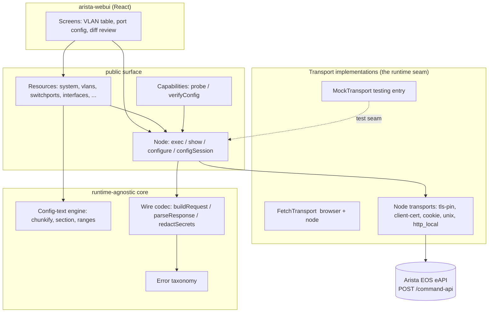
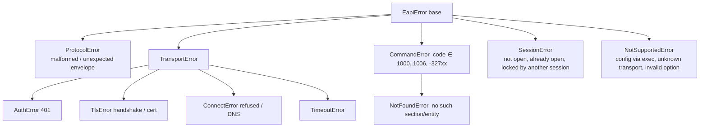
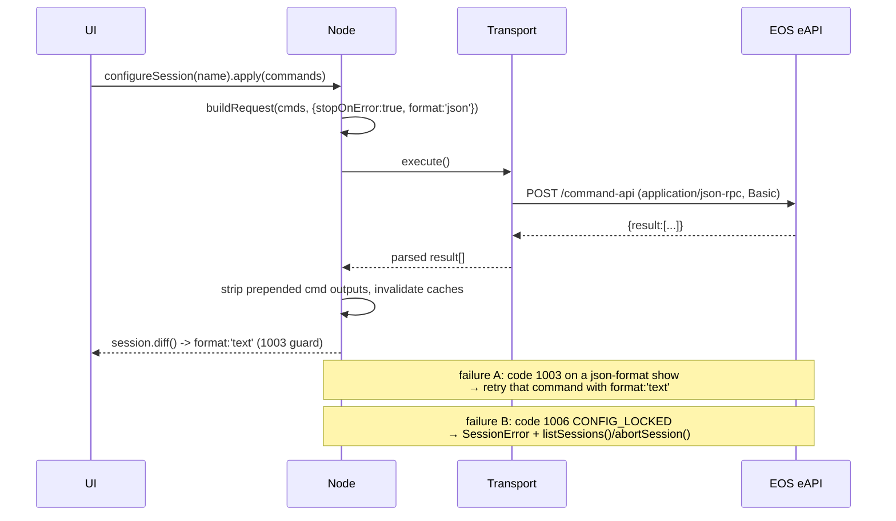

# Architecture — `arista-api-client`

Design of the TS eAPI client. Decisions behind it are in [DECISIONS.md](./DECISIONS.md); the
pyeapi cross-reference is [MIGRATION.md](./MIGRATION.md); build/test mechanics are in
[TESTING.md](./TESTING.md).

---

## 1. Layering



Dependency rule (enforced by lint, see §6): `resources → node → wire → errors`, `transports` may not
import `resources`, `core` may not import `transports`. The only cycle-safe seam is `Node` holding a
`Transport` **interface**.

---

## 2. What each layer owns

**Wire codec (`src/internal/wire.ts`)** — pure functions, zero I/O:
`buildRequest(commands, options) → JsonRpcRequest`, `parseResponse(raw) →
{ok:true,result}|{ok:false,error}`, `redactSecrets(payload|message)`. Everything about the JSON-RPC
contract lives here, and it is 100 % unit-testable from fixtures. The parameter surface is exactly
EOS 4.28's `runCmds`: `version: 1 | 'latest'`, `format: 'json' | 'text'`, `cmds`,
`autoComplete`, `expandAliases`, `timestamps`, `stopOnError`, `includeErrorDetail`,
`requestTimeout`. A command is `string | { cmd, input?, revision? }` — those three keys are the only
ones the server validates (`JsonCli.py:36-39, 397-424`).

**Transports (`src/transports/`)** — the seam that makes the dual-runtime decision work (DR-002). Owns
credential attachment (Basic / cookie / cert), TLS trust, timeouts, and HTTP-level failure mapping.
It never parses command semantics and never retries writes (DR-019).

```ts
export interface Transport {
  readonly kind: TransportKind;              // 'https | http | https-client-cert | session | unix | http-local | mock'
  readonly address: string;
  execute(commands: CommandSpec | readonly CommandSpec[],
          options?: TransportExecOptions): Promise<SendRequestResult>;
  close(): Promise<void>;
  toString(): string;
}
```

`execute()` resolves to M1's `SendRequestResult` (the `{ok: true, request, encoding, result,
viaTextRetry}` / `{ok: false, request, error, viaTextRetry}` union), not a bare `EapiReply`: the codec
owns the 1003 → `format:'text'` repair (DR-012) and the response-id check (DR-017), so `Node` reads the
encoding that actually answered off the result instead of guessing it. Device failures are typed errors
(`CommandError` / `ProtocolError`) in that union, never thrown by the transport contract.

**Node (`src/command-layer.ts`, M4 #6 — exported from both entry points)** — the command layer:
`runCommands`, `exec` (pyeapi `enable`, with the 1003 text fallback reported as `encoding` + `fellBack`),
`show<T>` / `showText` over the augmentable `ShowContracts` map, `configure` / `configureVariants`,
`getConfig` and the async config accessors, memoised device identity (`getVersion`), and cache
invalidation (`refresh`). This is pyeapi's `client.Node` minus the stashed errors, the `response`
duplicate and everything M5/M6 own: no config-session verbs (`configSession`/`diff`/`commit`/`abort`,
M5 #7) and no `section()`/`_chunkify` (M6 #8). `src/node.ts` is the **Node-runtime entry point** (the
`./node` export condition), not this class — see §6.

**Config-text engine (`src/internal/config-text.ts`)** — `chunkConfig`, `configSection`,
`getBlock`, `expandRange`, `collapseRange`, line/quote helpers. Every resource module in pyeapi is
built on parsing running-config, so this engine is the shared substrate; it is where most new tests go,
because upstream coverage of `_chunkify` is thin.

**Resources (`src/resources/`)** — one module per pyeapi api file. A resource:
(1) reads entity state by parsing a `show`, model-backed where one exists (DR-031);
(2) emits command **strings** (arrays of `CommandSpec`), never sends them itself;
(3) exposes typed verbs and throws on failure.
Keeping command generation separate from command execution is what makes capability probing, dry-run
via `verifyConfig`, and the diff screen possible.

**Capabilities (`src/capabilities.ts`)** — new, not in pyeapi: `probe(feature)` (DR-033) and
`verifyConfig(configlets)` for real dry-run review.

---

## 3. Types at the boundaries

```ts
// src/types/eapi.ts
export type CommandSpec = string | { cmd: string; input?: string; revision?: number };

export interface RunCmdsParams {
  version: 1 | 'latest';
  format: 'json' | 'text';
  cmds: CommandSpec[];
  autoComplete?: false;              // pyeapi exposes it; keep, don't encourage
  expandAliases?: boolean;
  timestamps?: boolean;
  stopOnError?: boolean;             // EOS default true
  includeErrorDetail?: boolean;
  requestTimeout?: number;           // seconds, server-side
}

export interface ShowContracts {     // consumers may augment via declaration merging
  version: ShowVersionReply;
  'interfaces status': ShowInterfacesStatusReply;
  vlan: ShowVlanReply;
  'configuration sessions': ShowConfigSessionsReply;
}
export type ShowReply<K extends keyof ShowContracts> = ShowContracts[K];
```

Resource contracts are narrow and named (`VlanEntry`, `SwitchportEntry`, `InterfaceEntry` union of
`EthernetEntry | PortChannelEntry | VlanEntryInterface | ManagementEntry`) so the webui renders tables
without `any` casts. `undefined` (never `null`) for absent optionals —
`exactOptionalPropertyTypes` is on in `tsconfig`.

---

## 4. Error taxonomy



Rules:
- Every error carries `commands` (the `CommandSpec[]` that produced it) — as pyeapi does — plus
  `requestId` (DR-017), and `redacted` message text (DR-011).
- `CommandError` exposes `code`, `commandError`, `results[]` (outputs of commands that *did* run),
  `failedCommand`, and `trace()` (pyeapi `get_trace`, `eapilib.py:143-160`, kept because the diff
  screen wants it).
- Only `-32602`/`-32601`/`-32700` are client-programming mistakes: they surface in tests, not in UI
  error toasts, and are not translated into user-facing copy.
- Codes are handled as data (`switch (e.code)` over the frozen map), never by string matching on
  messages — EOS message text is not API.

---

## 5. Runtime split: one core, two entry points

| | `@devhax-heavy-industries/arista-eapi` (browser) | `@devhax-heavy-industries/arista-eapi/node` |
|---|---|---|
| Transport | `FetchTransport` (`fetch`, `AbortController`) | fetch/undici + `node:tls`/`node:net` for unix socket, client certs, fingerprint pinning |
| Auth | Basic header injected by the proxy, or `cors allowed-origin` direct | Basic, cookie `/login`, client-cert |
| Profiles | injected object (DR-038) | `eapi.conf` file (DR-038), `EAPI_CONF` env |
| TLS trust | the browser/proxy's problem (DR-013) | explicit `ca` / `fingerprint` |
| Session journal | `localStorage` | file under XDG config dir (DR-022) |
| Local eAPI (unix / `127.0.0.1:8080`) | **absent** (DR-008) | opt-in, warnings (DR-014) |

Build enforces it: the browser bundle is built with `platform: 'browser'` and any `node:` import is a
build error; the Node build is the only one that registers the extra `TransportKind`s.
A `BrowserSafety.test.ts` guard asserts that constructing `kind: 'unix'` from the browser entry throws
`NotSupportedError`.

---

## 6. Source layout and import rules

```
arista-api-client/
  src/
    index.ts                # public surface, browser-safe (M1 codec + errors, M2 fetch/http, M4 Node)
    node.ts                 # `./node` entry: the Node-only transport kinds + createTransport (NOT the Node class)
    command-layer.ts        # `Node` — the command layer (M4 #6), re-exported from both entries
    errors.ts
    types/                  # wire + contract types (no runtime code)
    testing/                # mock-transport.ts, fake-sender.ts, recording.ts, loopback-device.ts — tests only,
                            #   not reachable from either entry point (browser-safe: no `node:` import)
    internal/               # wire.ts, redact.ts, warn.ts, variants.ts (M4) | config-text.ts (M6),
                            #   ranges.ts/collections.ts/journal.ts (M6/M7/M5 — planned)
    transports/             # contract.ts, base.ts, create.ts, correlate.ts, endpoint.ts, auth.ts,
                            #   error-map.ts, local.ts, fetch.ts, node-{create,https,tls,http,cookie,
                            #   client-cert,unix,http-local}.ts (the `./node` senders)
    resources/              # base.ts + one dir/file per pyeapi api module (M7 #9 onward)
    profiles.ts             # M3 #5 planned (Node entry only — `eapi.conf`, DR-038)
    capabilities.ts         # M11 #13 planned (DR-033)
  test/fixtures/            # wire/ and show/ samples (hand-authored, synthetic until M12 #14 records captures)
  docs/                     # this set
```

`command-layer.ts` imports **only types** from `src/transports/` (the `Transport` interface) and values
from `src/internal/`, so the runtime graph stays acyclic and the same class runs over the browser and
Node senders — see §1's layering rule and `src/browser-safety.test.ts`.

Lint rules (oxlint, root config extended by the package): `import/no-cycle`, no `node:*` in files
reachable from `src/index.ts` (via a boundaries plugin or an explicit `no-restricted-imports` glob),
`src/internal/**` not importable from `resources/*` except through the resource base, `no-floating-promises`
equivalent enforced by `@typescript-eslint/no-floating-promises` in the repo's existing lint setup if
oxlint's rule set doesn't cover it — check `npm run lint` after wiring M0 and add a plugin if needed.

---

## 7. Concurrency & state model

- A `Node` is **not** thread-safe in the "one config at a time" sense: EOS serialises configuration
  (and returns 1006 when locked). The client keeps a single in-flight mutation per `Node`
  (a promise chain guard) so the webui cannot fire two `configure()` calls in parallel and create an
  indeterminate pending session (DR-025). **Not yet implemented:** M4 (#6) shipped `configure()` without
  that guard and without the session state it depends on — the guard lands with the config-session work
  in M5 (#7), and until then a caller must serialise its own writes.
- Read paths may be parallel; each request has its own id and the response is matched by id.
- Caches: `running-config`/`startup-config` text, `chunkConfig` result (DR-026), parsed profile list,
  probed capabilities (TTL). All invalidated by `refresh()` or explicitly. Shipped by M4 (#6): the two
  config texts, cleared by `refresh()` or by a write while `autorefresh` is on; the parsed device
  identity (`getVersion`) is memoised and **deliberately not** cleared, matching pyeapi's `refresh()`
  (`client.py:991-1001`) — MIGRATION.md §5 row 35. `chunkConfig` (M6 #8), profiles (M3 #5) and
  capabilities (M11 #13) are still planned.
- No module-level mutable singletons (pyeapi's `config = Config()` at import is a deliberate
  non-goal, DR-038).

---

## 8. Request lifecycle (happy path + the two interesting failures)



---

## 9. Extension points the webui depends on

1. Augmentable `ShowContracts` (declaration merging) so app code gets typed `show` output without
   waiting for upstream releases.
2. `node.resource(name)` registry for dynamic tables (typed off the same map as the static accessors).
3. `src/testing.ts` `MockTransport` — the webui can render loading/error/empty states without a switch,
   and its component tests stay honest about what the client actually returns.
4. Pure `CommandSpec[]` output from resources: lets the webui show *the commands* in a confirmation
   dialog, which is the safest UX for a switch you only own one of.
5. Capability results as data (`{feature, supported, reason: 'no-such-command' | 'not-eapi-drivable'
   | 'denied' | 'locked'}`) so the UI can disable a control and say why (DR-033).
