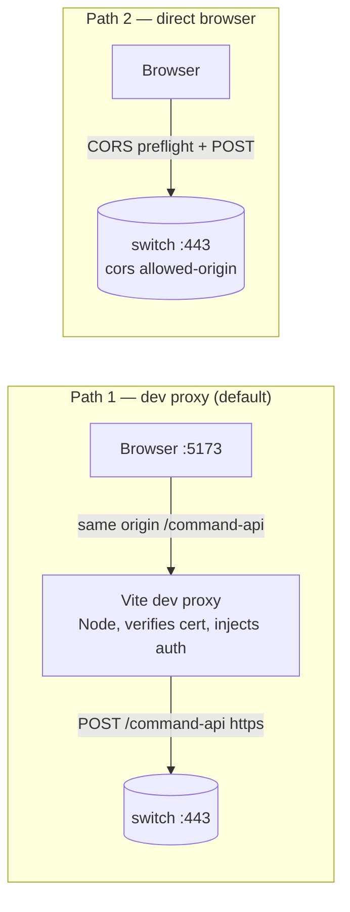

# Getting from the client to the switch (EOS 4.28.13.1M)

Everything on this page was verified against the 4.28.13.1M image (nginx/uWSGI config generators and
`CliPlugin` sources), not against the older eAPI User Guide — arista.com was unreachable from this
environment (HTTP 403), so **[DECISIONS.md open items](./DECISIONS.md#open-items-need-the-device)** list
what still needs a device sweep.

For the newly available **cEOS-lab 4.28.14M**, use the
[cEOS runbook](../../docs/CEOS.md) for container bootstrap, loopback HTTPS port mapping,
TLS trust, readiness, and test isolation. The image-derived facts on this page refer
to **4.28.13.1M**, not a verified cEOS boot. Point the planned same-origin dev/E2E
proxy at the lab's published endpoint, never a fallback physical-switch profile;
keep credentials in the proxy process. Container port 443 is mapped to host 8443
in the runbook, so preserve the explicit port.

Two viable paths. Pick one; the client's `baseUrl`/`kind` options absorb the difference.



---

## 1. What eAPI looks like on the wire (both paths)

- `POST /command-api`, `Content-Type: application/json-rpc`, body = JSON-RPC `runCmds`.
  **POST only** — `GET` returns 405 (`ALLOWED_HTTP_METHODS = frozenset(['POST'])`).
- Auth: HTTP Basic is accepted directly (`Authorization: Basic …`), or a `Session=` cookie from
  `POST /login` (cookie auth is Node-only — a browser cannot set a cross-origin `Cookie` header).
- Command object keys accepted by the server: `cmd`, `input`, `revision` — nothing else.
- Listeners on 4.28.13.1M: `https` on **443** (on by default), `http` on 80 (off by default),
  `http localhost` on **8080** (off by default, **loopback-only, plain HTTP — there is no 8443**),
  unix socket `/var/run/command-api.sock` (off by default).
- The two loopback listeners run with `DISABLE_AAA 1` → **unauthenticated priv-15**. Never expose
  8080 beyond the switch itself; do not enable `protocol http localhost` to "make the UI work".

---

## 2. Switch-side configuration

```
! read-only operator style user for the UI (privilege 15 so no `enable` command is needed)
username ui-admin privilege 15 role network-admin secret sha512 $6$…

management api http-commands
   no shutdown
   protocol https                      ! default, port 443
   ! Path 2 only — exact origin of the UI, repeatable:
   cors allowed-origin https://localhost:5173
   ! optional hardening:
   !  ip access-group EAPI-ONLY
   !  vrf mgmt                        ! only if the switch reaches your LAN through a mgmt VRF
   !  protocol https ssl profile WEBUI-CERT     ! CA-signed device cert instead of self-signed
```

Two gotchas that will waste an afternoon:

1. **Mutually exclusive server modes.** Server-level knobs (protocols, cert, ssl profile, **cors**,
   dscp, log level) must all live in *one* mode: `management api http-commands` **or** the newer
   `management http-server`. Mixing them errors with *"Cannot configure server in mode 'api
   http-commands' because there is server configuration in mode 'http-server'"*.
   Which style your device config already uses: `show management api http-commands` and
   `show management http-server`.
2. **`mgmt ip http`, the legacy HTTP management GUI, is not the eAPI switch.** Enabling the web GUI
   does nothing for `/command-api`.

Verify with a read-only call:

```bash
curl -sk -u ui-admin:PASS -H 'Content-Type: application/json-rpc' \
  -d '{"jsonrpc":"2.0","method":"runCmds","params":{"version":1,"format":"json","cmds":["show version"]},"id":"probe"}' \
  https://switch.home.arpa/command-api
```

That single call also settles several open items (`modelName`, version). Add
`show license features`, `show configuration sessions`, `show management api http-commands` to the same
sweep when you run it.

---

## 3. Path 1 — dev proxy (default recommendation)

Why: EOS hands out an auto-generated self-signed cert (`/persist/secure/capi.pem`), and nginx emits
CORS headers **without `always`**, so on 4xx (e.g. a wrong password) the browser sees an opaque
"Failed to fetch" instead of a 401. A same-origin proxy keeps credentials out of browser code and
avoids device-side CORS configuration. The current Vite development proxy sets `secure: false`, so
it does **not** verify the upstream certificate; use it only on a trusted development host/network
with an authorized lab target. A production proxy must verify a CA or pinned certificate.

```ini
# arista-webui/.env.local (ignored by git; use a lab-only account)
EAPI_HOST=localhost:8443
EAPI_USER=eapi-test
EAPI_PASS=replace-with-a-lab-only-password
```

Run `npm run dev -w arista-webui` from the workspace root. Vite binds to `127.0.0.1`; with all
three variables present it accepts an HTTPS host (optionally with a port) and injects Basic auth on
the server side. With all three absent it starts without a proxy and the UI sends no eAPI request;
partial configuration is rejected. It does not choose a fallback endpoint. The browser constructs
the client without credentials:

```ts
const node = createNode({
  kind: 'http',
  baseUrl: window.location.origin,
  path: '/command-api',
}); // loopback same-origin; credentials are held by the Vite dev process
```

Proxy rules the client's design assumes (and that a production proxy must keep):
- forward the body byte-for-byte (never "helpfully" rewrite `cmds`),
- keep `Content-Type: application/json-rpc`,
- **do not forward browser cookies to the switch** (mixing a cookie-authenticated device session with a
  browser origin is the CSRF-shaped surface here — eAPI has no Referer/CSRF check),
- translate 401/TLS failures into a JSON error the client maps to `AuthError`/`TlsError`,
- single upstream connection per request (each `runCmds` is its own CLI session on EOS),
- do not enable HTTP keep-alive credential caching across users.

`secure: false` is acceptable **only** for `vite dev` bound to loopback. Before M13 closes, replace it
with a pinned CA: capture the cert with `openssl s_client -showcerts -connect switch:443` and pass
`ca:` in the proxy target options — that's the "pin the device key" work tracked in M2.

---

## 4. Path 2 — direct browser access

Requirements, all four:
1. `cors allowed-origin <exact UI origin>` on the switch (§2). The origin must match
   `http(s)://host[:port]`; `all`/`*` is available but then `credentials: 'include'` is off the table.
2. The device cert trusted by the browser/OS (import `capi.pem`, or use an `ssl profile` with a
   CA-signed cert). Without this the fetch dies before CORS is even evaluated.
3. `createNode({ kind: 'https', host, username, password })` — Basic auth from the browser. Preflight
   is required because `application/json-rpc` is not a simple content type; the switch's
   `Access-Control-Allow-Headers` list already covers `Authorization` and `Content-Type`.
4. Accept the limitation: any 4xx from EOS will read as a network error (no CORS headers on error
   responses). Build the "bad credentials" UX on Path 1, or pre-flight `show version` through the proxy.

---

## 5. TLS on this device

- eAPI's cert is auto-generated, self-signed, ~30 000-day validity; regenerated if invalid.
- Options, in preference order: (1) CA-signed cert via `ssl profile`; (2) import the device cert into
  the trust store of the machine running the client; (3) **pin the SHA-256 fingerprint**
  (`tls: { fingerprint: 'sha256:…' }`) and treat a change as a security event.
- `HttpServiceConstants.py:44` lists `DEFAULT_TLS_PROTOCOLS = ['1.0','1.1','1.2']`, which looks stale;
  TLS 1.3 via ssl profiles on this SKU is unverified. Inspect with
  `show management api http-commands https certificate`.
- The Node transport refuses to connect on a verification failure and prints the observed fingerprint —
  that output is the intended way to *capture* a pin on first contact, not a reason to disable
  verification.

---

## 6. Which transport to pick

| Situation | `kind` | Notes |
|---|---|---|
| webui, `vite dev` on your laptop | `http` (same-origin, proxied) | Path 1; no creds in the browser |
| webui served from the switch / same origin | `https` | needs CORS or same-origin |
| one-off Node script over the LAN | `https` + `tls.fingerprint` | the everyday CLI path |
| CLI *on* the switch (or its netns) | `unix` or `http-local` | unauthenticated priv-15: opt-in + warning (DR-008/DR-014) |
| debugging with a browser session (`curl`-like cookie flow) | `https-session` | Node only; always `close()` → `/logout` |

Management VRF: if the switch's eAPI IP is in `vrf mgmt`, the client-side `host` must be routable in
that VRF (`telnet vrf`, a routed laptop, or the switch-local transports) — the VRF is a *device*
config knob (`management api http-commands vrf <name>`), not a client option.
