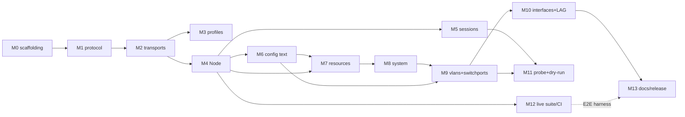

# Implementation Plan — `arista-api-client` (pyeapi → TypeScript)

Baseline source: **pyeapi 1.0.4-rc0** (`develop`, `6816d9e`) at `/home/svaj/development/arista/pyeapi`.
Target: a modern TypeScript eAPI client in [`arista-api-client/`](../), consumed by [`arista-webui/`](../../arista-webui/).

Read first: [DECISIONS.md](./DECISIONS.md) (why the plan looks like this) ·
[MIGRATION.md](./MIGRATION.md) (pyeapi → TS name-by-name map) ·
[ARCHITECTURE.md](./ARCHITECTURE.md) (layers and types) ·
[TESTING.md](./TESTING.md) (test strategy) ·
[STATUS.md](./STATUS.md) (live progress board).

---

## 1. Scope confirmed with the owner

| Question | Decision |
|---|---|
| Runtime | **Dual**: Node-capable core + browser-safe entry point. Unix socket, cert pinning, mTLS = Node-only. |
| Fidelity | **Idiomatic TypeScript** + a mapping doc. Not a line-by-line port. |
| Wave 1 modules | Core + `system`, `vlans`, `interfaces`, `switchports`. Others = later waves. |
| Tests | Offline (MockTransport + recorded fixtures) is the default; opt-in real-EOS integration/live and browser E2E prefer disposable cEOS-lab 4.28.14M. Hardware-only checks remain separate; never in `npm test`. See [cEOS runbook](../../docs/CEOS.md). |
| Packaging | Root **npm workspaces**; `@devhax-heavy-industries/arista-eapi` built with Vite/Rolldown lib mode + `tsc` declarations. |
| Docs/tracking | Markdown under `arista-api-client/docs/`, **plus** one GitHub issue per milestone with burn-down checklists. |

### Explicitly **not** ported (upstream line refs in [MIGRATION.md §7](./MIGRATION.md#7-dropped-on-purpose))
`Node.api('name')` string module autoload · duplicate `response` key in `enable()` results ·
`BaseEntity.error` swallow-and-stash idiom · deprecated `value=None` negation in `command_builder` ·
`_find_sub_json` general-purpose JSON matcher (only needed to redact `enable` input) ·
`pyeapi.utils.debug`/`islocalconnection` · `streaming: true` request mode.

---

## 2. Milestone overview

| ID | Milestone | Outcome / exit gate | Depends on | Est. |
|---|---|---|---|---|
| M0 | Workspace & package scaffolding | `npm test`/`lint`/`typecheck`/`build` green in the new package; webui can import it | — | S |
| M1 | Wire protocol core | Encode/decode `runCmds`; full error taxonomy; secret redaction | M0 | M |
| M2 | Transports | `https`, `http`, `https_certs`, `https_session`/`http_session`, unix/http_local (Node), browser+proxy | M1 | M |
| M3 | Connection profiles | `eapi.conf` reader (Node) + in-memory profile store, tagged hosts | M2 | S |
| M4 | `Node` command layer | `exec` / `show` / `showText` / `configure` / config caching / `version`, `model` | M2 | M |
| M5 | Config sessions & change safety | Named, resumable sessions; diff/commit/abort; `configure replace`; `copy run start`; orphan recovery | M4, M6 | M |
| M6 | Text-config engine | `chunkify` port + fixes, `section()`, `getBlock()`, range expand/collapse | M4 | M |
| M7 | Resource framework | `BaseResource`/`Entity`/`EntityCollection` equivalent + `command()` builder | M4, M6 | M |
| M8 | `system` resource | hostname, ipRouting, banners (multiline) | M7 | S |
| M9 | `vlans` + `switchports` | VLAN CRUD + trunk/access mode/group config — first usable UI slice | M7, M8 | M |
| M10 | `interfaces`: base, ethernet, port-channel | Interface CRUD, LAG/LACP (`setMembers`, `lacpFallback`, `minimumLinks`) | M7, M9 | L |
| M11 | Capability probe + dry-run | `verifyConfig` dry-run; probe that classifies 1002/1004/1005/1006 per feature | M5, M9 | M |
| M12 | Live-device suite + fixtures + CI | cEOS provisioning/readiness, recorder, guarded real-EOS suite, coverage gate, trusted CI | M4 | M |
| M13 | Consumption, docs, release | webui dev-proxy wiring, typed `show` contracts, cEOS browser E2E, CHANGELOG, semver/tag policy | M9, M10; M12 for E2E | S |
| W2 | Wave-2 modules (backlog) | `users`, `acl`, `stp`, `mlag`, `varp`, `ipinterfaces`, `vrfs`, `staticroute`, `ntp` | M10 | L |
| W3 | Wave-3 modules (backlog) | `ospf`, `bgp`, `routemaps`, `vrrp`, `VxlanInterface` | W2 | L |

Sizes: S ≈ ½–1 day of agent work, M ≈ 1–3 days, L ≈ 3–6 days (wall-clock for a pair of focused sessions).

---

## 3. Milestones in detail

### M0 — Workspace & package scaffolding
**Goal:** the package exists, builds, lints, tests, and is importable from `arista-webui` by name.

- [x] Create root `package.json` with `"private": true`, `"workspaces": ["arista-api-client", "arista-webui"]`, and root scripts `build`, `test`, `lint`, `typecheck` that fan out to both packages.
- [x] `arista-api-client/package.json`: name `@devhax-heavy-industries/arista-eapi` (**DR-020 open**), `"type": "module"`, engines `node >= 20`, sideEffects false.
- [ ] Scripts mirroring the webui: `build` (vite lib mode) · `typecheck` (`tsc -b`) · `lint` (`oxlint`) · `test` (`vitest run --project unit`) · `test:watch` (`vitest --project unit`) · `test:live` (`vitest run --project live`) · `coverage` (unit project only) · `docs`.
- [x] `exports` map with conditions: `"."` → browser-safe build; `"./node"` → Node build (unix socket, client certs); `"./package.json"`. Types first, `import` only (no CJS) — **DR-021**.
- [x] `tsconfig.json` + `tsconfig.build.json`: `strict`, `noUncheckedIndexedAccess`, `exactOptionalPropertyTypes`, `verbatimModuleSyntax`, `isolatedModules`, `declaration` + `declarationMap`, `emitDeclarationOnly` for the types step. `target: ES2022`, `lib: ["ES2023", "DOM"]`.
- [x] `vite.config.ts` lib mode (rolldown) with two entries (`index.ts`, `node.ts`), `formats: ["es"]`, externals left external (`node:net`, `node:tls`, `node:fs`).
- [x] `vitest.config.ts` with `projects`: `unit` (node env, excludes `*.live.test.ts`) and `live` (include only `*.live.test.ts`, `pool: forks`, run only via `test:live`). Coverage provider `v8` with thresholds (see TESTING.md).
- [x] `.oxlintrc.json` at repo root (shared by both packages) with the `typescript` + `import` plugin rules; per-package overrides. If `oxfmt` is available in the pinned `oxlint` major, adopt it and disable Prettier.
- [x] Source skeleton: `src/index.ts`, `src/node.ts`, `src/internal/`, `src/resources/`, `src/types/`, `src/testing/` (public test helpers), `.gitignore`, `LICENSE` (**BSD-3-Clause, retaining Arista's copyright — DR-001**), `NOTICE` attributing the pyeapi port.
- [x] CI: GitHub Actions workflow (Node 20/22 matrix, `typecheck` → `lint` → `test` → `build`; reserve real-EOS jobs for explicit trusted `workflow_dispatch`, per M12 and the cEOS runbook).
- [x] Verify the webui resolves the workspace package (`import { createNode } from '@devhax-heavy-industries/arista-eapi'` type-checks; Vite dev server serves it unbuilt during development).

> **M0 notes (2026-11-01, PR for #2 — what deviated and why):**
> * Every script named above exists **except `docs`** — no doc generator has been chosen and
>   adding one here would be an unjustified dependency. Docs/release tooling is M13's (#15).
> * `tsconfig` needed **three** projects, not two, so colocated tests are type-checked while
>   `dist/` stays clean: `tsconfig.json` (solution, like the webui's) → `tsconfig.build.json`
>   (composite, `emitDeclarationOnly`, excludes `*.test.ts`/`*.live.test.ts`),
>   `tsconfig.test.json` (noEmit, type-checks `src/**` including tests),
>   `tsconfig.node.json` (noEmit, type-checks `vite.config.ts`/`vitest.config.ts` — mirrors the webui).
> * `exports` gained a **`development` condition** (`./src/*.ts`) ahead of `import`, so `arista-webui`
>   dev/test consumes the TypeScript source with no library build and no `resolve.alias`; production
>   builds use `dist/`. `./testing` (DR-021) is **not** wired yet — nothing to point at until M1/M2.
> * Coverage `include` is `['src/**/*.ts']` rather than TESTING.md's `['src/**']`: the skeleton keeps
>   a one-page `README.md` in each `src/` subdirectory (git cannot store empty dirs) and the v8
>   provider tried to parse them (`PARSE_ERROR`).
> * `oxlint@1.90.0` ships only the `oxlint` bin — no bundled `oxfmt` — so there was nothing to adopt;
>   `oxfmt` exists only as a separate package and adopting it would reformat `arista-webui` too.
>   The existing `arista-webui/.oxlintrc.json` moved to the repo root and gained the `import` plugin
>   (`import/no-cycle`) plus an `arista-api-client/**` override that switches the React rules off.
> * Two build-order traps fixed: Vite's `emptyOutDir` deletes `dist/*.d.ts`, so the client's `build`
>   is `vite build && tsc -b --force`; and `arista-webui/tsconfig.json` references
>   `../arista-api-client/tsconfig.build.json` so a standalone webui typecheck has declarations
>   available (resolution is still by package name — no path alias).
> * The workspace lockfile moved from `arista-webui/package-lock.json` to the repo root.

**Exit gate:** `npm run build && npm run typecheck && npm run lint && npm test` green from the repo root; webui imports the package with no path hacks. ✅ met (2026-11-01).

---

### M1 — Wire protocol core
**Port of:** `pyeapi/eapilib.py` (request/response codec, error classes). **Do not** port the `http.client` transport subclasses here.

- [ ] `src/types/eapi.ts`: `JsonRpcId`, `CommandSpec = string | { cmd: string; input?: string; revision?: number }` (**only these three keys exist server-side**), `RunCmdsParams` (`version: 1 | 'latest'`, `format: 'json' | 'text'`, `cmds`, `autoComplete`, `expandAliases`, `timestamps`, `stopOnError`, `requestTimeout`, `includeErrorDetail`), `JsonRpcSuccess`, `JsonRpcFailure`, `EapiResponse` union.
- [ ] `buildRequest(commands, opts)` — mirrors pyeapi's param **allow-list** behaviour, then extends it to the four params pyeapi drops (`stopOnError`, `includeErrorDetail`, `requestTimeout`) → **DR-016**. Unknown params must be rejected at compile time *and* runtime.
- [ ] Request id policy: monotonic per-connection integer + optional client nonce (pyeapi uses `id(self)`, which is not unique across processes) → **DR-017**.
- [ ] `parseResponse(text)` → discriminated union; never throw on `error` — return the failure and let the caller raise. Malformed JSON → `ProtocolError` carrying the raw body (truncated to a limit).
- [ ] Error taxonomy in `src/errors.ts`: `EapiError` (base), `CommandError` (`code`, `message`, `commandError`, `results[]`, `failedCommand`, `trace()`), `TransportError` (+ subtypes `AuthError`, `TlsError`, `ConnectError`, `TimeoutError`), `ProtocolError`, `SessionError`, `NotSupportedError`. Numeric codes as a `const enum`-free frozen map: `-32700 -32600 -32601 -32602 -32603 1000 1001 1002 1003 1004 1005 1006`. **There is no 1007** → **DR-010**.
- [ ] `error.data` handling: array-of-results path (pyeapi `_parse_error_message`) **and** the `includeErrorDetail` object path `{result[], errorDetail[{index,code,message,cmd}]}`.
- [ ] `renderCommandError()` message format identical to pyeapi (`Error [code]: msg [err]` for 1000/1001/1002/1004, `Error [code]: msg` otherwise) so device-sourced text stays comparable.
- [ ] Secret redaction (**DR-011, a real fix over pyeapi**): redact `input` for `{'cmd':'enable', input}` in (a) log/debug output and (b) *every* error message, not just 1005 — EOS appends `input=%r` to messages for 1000/1001/1002/1004 too. Also redact passwords in `username … secret …` commands before logging. Reuse the `{'cmd':…, 'input':…}` shape matching from `pyeapi/eapilib.py:502-566` inline (do **not** port the generic `_find_sub_json`).
- [ ] `-32602` decoration: when the message matches `unexpected keyword argument '(.*)'`, append `"parameter is not supported in this version of EOS"` (pyeapi `eapilib.py:460-468`).
- [ ] `text`-encoding fallback hook: on **1003** (`COMMAND_UNCONVERTED`) re-issue the single command with `format: 'text'` — matching pyeapi `Node.enable(strict=False)`; keep `strict` semantics under a different name (`{ tolerateErrors: false }`) → **DR-012**.

**Tests (high priority — port of `test/unit/test_eapilib.py`, 38 methods):**
- [ ] `buildRequest`: cmds passthrough, string→array coercion, param allow-list, `version: 'latest'`, explicit `stopOnError:false`, `includeErrorDetail:true`, rejection of a bogus param.
- [ ] Every envelope sample in `test/fixtures/wire/*.json`: success, `error` with `data[]`, `error` with `errorDetail`, `-32700`, `-32601`, empty `data` omitted.
- [ ] One assertion per code 1000-1006 → expected class + `.code` + rendered message.
- [ ] Redaction: enable-input never appears in `error.message`, `Error.toString()`, or the logger output (assert on the *serialised* error).
- [ ] 1003 → automatic text retry, and 1003 with `tolerateErrors:false` → throws.
- [ ] Type tests (`expectTypeOf`) that `show<T>()` narrows by command literal.

**Exit gate:** encode + decode are pure (no I/O), fully covered, and fixture-driven.

---

### M2 — Transports
**Port of:** `EapiConnection` + the 7 subclasses in `eapilib.py` (68-757) and `TRANSPORTS` in `client.py:112-121`.

- [ ] `interface Transport { execute(commands, opts): Promise<EapiReply>; close(): Promise<void>; readonly kind: TransportKind }`. Transport is the seam that makes the dual-runtime decision work → **DR-002**.
- [ ] `FetchTransport` (shared, browser-safe): POST to `<base>/command-api`, `Content-Type: application/json-rpc`, `Authorization: Basic`, timeout via `AbortController` (pyeapi default `timeout: 60` seconds — keep 60 000 ms).
- [ ] Node TLS options (`./node` entry): `ca`, `cert`, `key`, `serverName`, **`fingerprint`** (pin self-signed device cert), `rejectUnauthorized` guarded by an explicit `dangerouslyDisableTlsVerification` flag — never a silent default → **DR-013**. pyeapi's `enforce_verification`/`context` knobs are **not** reproduced; they are documented as "replaced by explicit options".
- [ ] `HttpTransport` ( cleartext ) — allowed only for `http://` loopback or when `allowInsecureTransport: true`; log a warning. Replaces pyeapi `http`.
- [ ] `ClientCertTransport` = pyeapi `https_certs`: requires `cert`+`key`, verification on when `ca` given, off (with warning) when omitted — same semantics as `HTTPSCertConnection.connect()`, but surfaced as explicit options and Node-only.
- [ ] `SessionCookieTransport` = pyeapi `http_session`/`https_session`: `POST /login {"username","password"}` → capture `Set-Cookie`, then send it on `/command-api`. Node-only (browser cannot set `Cookie` on a cross-origin request). Must handle non-200 → `AuthError`, and must never echo the body. Logout/`POST /logout` added (pyeapi never logs out) → **DR-018**.
- [ ] Local transports (Node-only, feature-flagged): `UnixSocketTransport` (`/var/run/command-api.sock`) and `HttpLocalTransport` (`127.0.0.1:8080`, **plain HTTP only — 4.28 has no 8443 listener**; pyeapi's `DEFAULT_HTTPS_LOCAL_PORT` is a legacy constant) → **DR-014**. Both must print a security warning: EOS marks these `DISABLE_AAA` → unauthenticated priv-15.
- [ ] `TransportKind` string union + a `createTransport(options)` factory with an exhaustive switch (compile error when a kind is unimplemented).
- [ ] Error mapping: HTTP 401 → `AuthError` (pyeapi raises `ConnectionError`); HTTP 405 → `ProtocolError` (eAPI is POST-only); `ECONNREFUSED`/DNS/TLS handshake → `ConnectError`/`TlsError`; socket hang-up → `TransportError` with `retryable` hint.
- [ ] Retry policy: none at transport level by default (config writes are not idempotent). `readOnly: true` requests may retry once on `ConnectError` → **DR-019**.
- [ ] `MockTransport` in `src/testing/`: scripted replies by command match + a `recording` mode used by M12.

**Tests (high priority — port of the connection half of `test_eapilib.py` + `test_client.py::test_connect_*`):**
- [ ] Request headers: content type, basic-auth string parity with pyeapi for `admin:` (byte-exact base64), absent auth when no credentials.
- [ ] 401/403/405/ECONNREFUSED/TLS-failure paths each throw the mapped error and attach `commands`.
- [ ] Timeout: `AbortController` fires at the configured ms; error is `TimeoutError` not `ProtocolError`.
- [ ] Cookie transport: login POST body shape, cookie reuse on the following call, non-200 login → `AuthError`.
- [ ] Cert transport: missing `key`/`cert` → `TypeError` at construction (pyeapi `ValueError`).
- [ ] Local transports: unix path default, `8080` default, warning emitted, refusal to construct in the browser build (guard test).
- [ ] `dangerouslyDisableTlsVerification` warns; omitting it against a self-signed cert fails with `TlsError`.

**Exit gate:** every pyeapi transport has a TS equivalent or a documented, deliberate omission; no Node built-ins reachable from the browser entry (enforced by a build-time check).

---

### M3 — Connection profiles
**Port of:** `client.py` `Config`, `load_config`, `config_for`, `hosts_for_tag`, `connect`, `connect_to`.

- [ ] Decide the profile source: **Node** reads `~/.eapi.conf` and `/mnt/flash/eapi.conf` (INI, `[connection:name]`, honour `$EAPI_CONF`); **browser** receives profiles from app config (`createProfiles(...)`) — never filesystem access → **DR-038**.
- [ ] Minimal INI parser (no dependency) + malformed-file tolerance (pyeapi logs and continues) and the `host` defaulting quirk (`client.py:207-211`: a section without `host` gets `host = <name>`).
- [ ] Keep pyeapi's implicit `connection:localhost` → socket default **only** in Node; the browser default must be `https` with no host → **DR-008**.
- [ ] `tags` support (`tags: a,b`) → `hostsForTag()`; `generateTags()` re-run semantics after `addConnection`.
- [ ] `connect(options)` / `connectTo(name)` equivalents: `createConnection(profile)` and `createNode(profile)`, returning a `Node` when asked; validate the transport name exhaustively.

**Tests (port of the config half of `test_client.py`):** fixture INI files (valid, malformed, missing `host`, tags, duplicate sections), autoload search-path order, `$EAPI_CONF` override, `connectTo('nope')` → `ProfileNotFound`.

---

### M4 — `Node` command layer
**Port of:** `client.py:464-955` (`Node.__init__`, `enable`, `run_commands`, `config`, `get_config`, `refresh`, `version`/`model`).

- [ ] `class Node` with `readonly connection: Transport` and lazy, cached `version`, `versionNumber`, `model` (parse from `show version` exactly like `_get_version_properties`, `client.py:557-575`).
- [ ] `runCommands(cmds, {encoding, sendEnable})` → raw `result[]` (pyeapi `run_commands`), including the `MULTILINE:` pseudo-syntax **replaced** by real `{cmd, input}` objects → **DR-015**.
- [ ] `exec(commands, opts)` = pyeapi `enable()`: returns `{command, result, encoding}` per command; `1003` retry-with-text; explicit `strict` → `tolerateErrors`; refuses config-mode commands with `NotSupportedError` (pyeapi raises `TypeError` when the literal `configure` is present).
- [ ] Drop the duplicate `response` key; keep only `result` → **DR-007**.
- [ ] `show<T>(command)` typed shell: `show('version')` → `ShowVersionReply`, `show('vlan 20')` → … via a `ShowCommandContracts` interface map that consumers can augment (declaration merging). This is the piece the webui builds on.
- [ ] `configure(commands)` (pyeapi `config`) → `configureTerminal` path; `configureSession` path arrives in M5. Both strip the prepended command's output (`response.pop(0)`) and clear config caches, and honour `autorefresh`.
- [ ] `enablePassword` handling: `node.setEnablePassword(pw)` → sends `{'cmd':'enable','input':pw}`; **document the priv-15-user shortcut**: with a `privilege 15` Basic-auth user, `sendEnable: false` and the `enable` command is unnecessary → **DR-009**.
- [ ] `getConfig({config:'running'|'startup', params:'all', as:'string'|'lines'})` with `configDefaults` support; validate the config name.
- [ ] `runningConfig` / `startupConfig` as **async accessors** (`getRunningConfig()`), since TS getters can't await; document the divergence from pyeapi properties → **DR-005**.
- [ ] `refresh()` invalidates cached configs; `autorefresh` default `true` preserved.
- [ ] `CliVariants` equivalent: `configure([...variant(a), ...])` → `{ variants: [['a','b'], ['c','d']] }` tried in order, re-raising the last `CommandError` (pyeapi `client.py:640-673`). Decide parity vs. ergonomics: keep as `tryVariants()` utility, not a type-level magic → **DR-006**.

**Tests (high priority — 53 pyeapi unit tests in `test_client.py`; port these 30):**
- [ ] `enable`: single/multi command, `send_enable` true/false, enable password insertion order, result indexing, `response.pop(0)` after `configure terminal`.
- [ ] `config`: chunk of commands order, `configure terminal` prefix, autorefresh off → no `refresh()` call, cache cleared afterwards.
- [ ] `get_config`: `running-config`/`startup-config`, `params` appended, `as_string` vs lines, invalid name throws.
- [ ] version/model parsing: fixture `show version` for `4.28.13.1M` + `DCS-7050TX-64`, and the no-match fallbacks.
- [ ] Error attachment: failing command set → error carries `commands`.
- [ ] Type-level: `show('version')` returns `ShowVersionReply`; unknown command → `unknown` (not `any`).

**Exit gate:** read-only work against a mocked switch is fully usable without any resource module (the "generic exec/show" escape hatch works).

---

### M5 — Config sessions & change safety
**Port of:** `configure_session`, `diff`, `commit`, `abort`, `_configure_session` (`client.py:676-696`, `1003-1040`) — plus EOS capabilities pyeapi never exposed.

- [ ] `node.configSession({ name?, description?, noCommit? })` → session object. pyeapi always fabricates a `uuid4`; **default our session name to a stable, prefixed id** (`ui-<host>-<pid?>-<uuid8>`) so a crashed client can find it again → **DR-022**.
- [ ] Every session command re-sends `configure session <name>` as command #1 (that *is* how EOS re-attaches; pyeapi relies on it too).
- [ ] `diff()` — must use `format:'text'`: `show session-config diffs` has no JSON model and returns **1003** under JSON (verified in the 4.28 image) → keep pyeapi's comment-but-fix-it: allow `show session-config` (JSON-capable) and force text for `diffs`.
- [ ] `commit()`, `abort()`, `exitSession()`, plus `commitWithRevertTimer(hh:mm:ss)` (EOS auto-revert; **semantics of the confirming second `commit` need device verification** — [open items](./DECISIONS.md#open-items-need-the-device)).
- [ ] `listSessions()` via `show configuration sessions` (**is** JSON-model-backed) + `recoverOrphans()` / `abortSession(name)` — pending sessions persist forever and hold the config lock, which is what produces **1006** for the next client → **DR-023**.
- [ ] `rollbackCleanConfig(groups?)`, `rollbackToSession(name)` (config-history rollback), `configureReplace(url, {ignoreErrors, force, md5, skipCheckpoint})` with the "cannot configure replace while session X is pending" guard surfaced as `SessionError`.
- [ ] `copyRunningToStartup()` / `writeMemory()` — pyeapi has nothing; a UI that commits is not durable without it → **DR-024**.
- [ ] `stopOnError` exposure: default `true` (EOS default); a whole-changeset validate mode uses `{stopOnError:false, includeErrorDetail:true}`.
- [ ] Session state machine in TS (`open | diffed | committed | aborted | lost`) + a guard that rejects `Node.configure()` while a session is open → **DR-025**.
- [ ] Persist session names to a small journal (Node: `~/.config/arista-eapi/sessions.json`; browser: `localStorage`) so recovery survives reloads.

**Tests (high priority):**
- [ ] Command sequence for open/configure/diff/commit/abort (assert exact `cmds` arrays — including text-forced `diffs`).
- [ ] Re-attach: two sequential `node.configSession({name})` calls produce `configure session <same name>` twice.
- [ ] Orphan recovery: fixture `show configuration sessions` output with a pending `ui-x` session → `recoverOrphans()` issues `configure session ui-x abort`.
- [ ] 1006 mapping → `SessionError('config locked')` with the offending session surfaced from `trace()`.
- [ ] `writeMemory` never auto-runs on commit (data-loss-safe default) and requires an explicit flag.

**Exit gate:** a change can be staged, reviewed as a diff, committed atomically, survived across a page reload, and cleaned up after a crash.

---

### M6 — Text-config engine
**Port of:** `client.py:193-245` `section`/`_chunkify` (lru_cache) and `utils.py:175-235` `expand_range`/`collapse_range`; `abstract.py:82-101` `get_block`.

- [ ] Port `_chunkify` as a pure function `chunkConfig(config: string): Map<string,string>` — indent-aware sections *and* nested sub-sections, with the recursion invariant (only the outer call may use `indent = 0`).
- [ ] Carry the two special cases: `banner … MULTILINE` / EOF-terminated blocks, and `code unit …` continuation lines. Keep the explicit failure mode for a short line inside an indented block ("likely unhandled multiline literal block").
- [ ] **Cache**: pyeapi uses an `lru_cache` on a method (a memory leak keyed by config text); replace with a content-hash `WeakMap`/single-entry memo invalidated on `refresh()` → **DR-026**.
- [ ] `section(regex, {config})` semantics preserved: first matching key, `NotFoundError` when absent (pyeapi raises `TypeError` — map to `NotFoundError` for sane `catch`) → **DR-027**.
- [ ] `getBlock(parent, config)` = anchored `^…$` lookup (`abstract.py:82`), returning `undefined` instead of throwing.
- [ ] `expandRange('1-3,7') → ['1','2','3','7']` and `collapseRange([...]) → '1-3,7'`; pyeapi's `*` and comma/range delimiters preserved. These drive `interface Ethernet1-4`, `vlan 10-20`, `switchport trunk allowed vlan`.
- [ ] Config-text helpers used by every resource: `findLine(config, re)`, `parseBlock(body)`, `unquote(value)` (EOS `"quoted string"` handling in `description`/`name`).

**Tests (high priority — pyeapi's own `_chunkify` coverage is thin; expect to write more than upstream):**
- [ ] Golden fixtures from real EOS: capture supported 4.28 config forms from cEOS early, and retain separate 7050TX-64 / 4.28.13.1M captures for target parity. Include `router bgp` sub-blocks (`address-family`), `vlan` blocks, `port-channel` with `member interface`, nested `mac security profile`, `class-map`/`policy-map` where supported; record unsupported cases explicitly.
- [ ] `banner motd MULTILINE: …\nEOF` block stays one section; `code unit` line grouping.
- [ ] Short-line-inside-block → the explicit ValueError-equivalent (`ConfigParseError`), not a wrong answer.
- [ ] `section()` returns the same text pyeapi would for those fixtures (parity assertions).
- [ ] Range helpers: pyeapi's 15 `test_utils.py` cases incl. `expand_range('1-3,5')`, mixed ports, invalid input.
- [ ] Property test (fast-check): `collapseRange(expandRange(x)) === canonical(x)` for generated ranges.

**Exit gate:** every wave-1 resource can be parsed from text config with no bespoke regex.

---

### M7 — Resource framework
**Port of:** `api/abstract.py` (224 lines: `BaseEntity`, `Entity`, `EntityCollection`) + `client.py:927` `Node.api()`.

- [ ] `class ResourceBase { constructor(protected node: Node) }` with `config()` access, `commandBuilder()`; drop `error` property entirely — every verb **throws** → **DR-005**.
- [ ] `Entity<T>` (`get(): Promise<T>` — for global-ish resources: `system`, `ntp`, `mlag`, `ospf`, `bgp`) and `Collection<T, K>` (`getAll`, `get(name)`, `create`, `delete`, `default`, plus `has`, `keys`, `entries`). No Python `Mapping`/`__call__` magic → **DR-004**.
- [ ] Verb naming rule (fixed and documented): read `get`/`getAll`; write `set<Field>`; presence `create`/`delete`/`setDefault`; collection membership `add<X>`/`remove<X>`. Identical to pyeapi so the mapping doc stays 1:1.
- [ ] Option objects replace `**kwargs` and the 4-arg `command_builder(string, value, default, disable)`: `setTrunkNativeVlan(id)`, `.disable()`, `.default()` become `{ mode: 'set' | 'no' | 'default' }` or dedicated `unsetX()` methods → **DR-037**. Preserve evaluation order **default → disable → value** in the one place it matters and unit-test it.
- [ ] Replace `isvalidinterface` / `isvlan` guards and `__getattr__`/`marshall` dynamic dispatch with explicit typed methods + runtime validators (`assertInterfaceName`, `assertVlanId`) → **DR-004**.
- [ ] Static accessors instead of `node.api('vlans')`: `node.vlans`, `node.interfaces`, `node.switchports`, `node.system` as lazily-constructed getters. A `node.resource('vlans')` string escape hatch may exist for the webui's dynamic tables, typed off a registry map.
- [ ] `command()` builder returns `string[]` (never mutates caller arrays; pyeapi's `configure_interface` `insert(0, …)` bug aside — see DR-004 note on the deprecated `value=None` path).
- [ ] Shared parsing base: `parseConfigBlock(body, fieldParsers)` — the shape every wave-1/wave-2 module needs (they read running-config, not dedicated `show` commands).

**Tests:**
- [ ] Command-builder truth table (set/no/default/`value===true`) — 12 cases, mirroring pyeapi's `test_abstract`-style assertions embedded in each module's tests.
- [ ] `configureInterface` wraps in `interface X` exactly once and doesn't mutate the input array (regression vs pyeapi).
- [ ] Throwing: a failing write rejects with `CommandError` (no silent `false`), with `.failedCommand` set.
- [ ] Registry: `node.vlans` returns the same instance twice; `node.resource('bogus')` throws.

**Exit gate:** the first resource module (M8) requires ~30 lines of new plumbing at most.

---

### M8 — `system` resource (wave 1)
**Port of:** `api/system.py` (186 lines: `get`, `_parse_hostname`, `_parse_iprouting`, `_parse_banners`, `set_hostname`, `set_iprouting`, `set_banner`).

- [ ] Types: `SystemSettings { hostname, ipRouting, banner?: { login?, motd?, exec? } }`.
- [ ] `get()` from `ip routing` / `hostname` / banner blocks.
- [ ] `setHostname(h)` with EOS name rules validated (length, no leading digit/space) — stricter than pyeapi.
- [ ] `setIpRouting(true|false)` via default/disable modes.
- [ ] `setBanner(kind, text)` using the multiline form `{"cmd":"banner motd","input":"text\nEOF\n"}`; strip the trailing newline pyeapi appends, and document why `input` must end with `\n` → **DR-015**.
- [ ] Out of pyeapi but cheap: `setNameServers`, `setIpDomainLookup`, `setSnmpLocation/Contact`? — mark **backlog**, don't scope-creep wave 1.

**Tests (7 pyeapi `test_api_system.py` + 20 system tests → 12 unit tests):** hostname set/get, `ip routing` set/no/default, banner multiline payload shape assert (no redaction leak in the logged payload), `get()` with a bare 4.28 minimal config, banner parse with embedded quotes.

---

### M9 — `vlans` + `switchports` (wave 1 — first demoable UI slice)
**Port of:** `api/vlans.py` (372) + `api/switchports.py` (417).

- [ ] `vlans.get(vid)` → `{ id, name, state: 'active'|'suspend', trunkGroups[] }`; `getAll()`; `create(vid)`, `delete(vid)`, `setDefault(vid)`; `setVlanName`, `setVlanState`, `setTrunkGroups`, `addTrunkGroup`, `removeTrunkGroup`. Validate `1..4094` (parse failure path in `_parse_vlan_id` preserved as `VlanNotFoundError` → **DR-027**).
- [ ] `switchports.get(name).getAll()` keyed by interface, plus `setMode`, `setAccessVlan`, `setTrunk` (native + allowed), `setTrunkNativeVlan`, `setTrunkAllowedVlans`, `addTrunkGroup`, `removeTrunkGroup`. Use M6 range helpers for `allowed vlan`; pyeapi's `_parse_trunk_allowed_vlans` `forwarding:trunk:allowed-vlans` fallback (`switchports.py:120`) → **DR-028** if it is unexplained: verify on device (`switchport trunk allowed vlan forward all`), keep behaviour, but document; **flag the `name=`-fallback hack at `switchports.py:147-151` as a known bug and record a decision** → **DR-029**.
- [ ] `interfaceMode` enum matching EOS (`access | trunk | dot1q-tunnel | private-vlan`), with `trunk groups` support gated by capability probe results from M11.
- [ ] Both modules must batch reads: one `show running-config` per `getAll()`, not one per entity (pyeapi re-parses config each call; keep the *behaviour* but add a per-call config cache) → **DR-030**.

**Tests (high priority — 15 + 21 pyeapi unit tests → ~40 of ours):** get on named/unnamed vlan, create with `name`, delete with dependents (`no vlan X` rejection → `CommandError`), state suspend/active round trip, `switchport mode` matrix, native vlan vs allowed set interactions, trunk group add/remove idempotence, and the `interface` sub-block parse from realistic JSON-ish fixtures.

**Exit gate:** the webui can list VLANs, assign an access port, and show a diff before commit — with only wave-1 modules.

---

### M10 — `interfaces`, ethernet + port-channel (wave 1, biggest module)
**Port of:** `api/interfaces.py` (1,101 lines — `Interfaces`, `BaseInterface`, `EthernetInterface`, `PortchannelInterface`, `VxlanInterface`).

- [ ] Split deliberately: **M10a** `Interfaces` facade + `BaseInterface` (get/getAll/create/delete/default, description,Shutdown, mtu, encap) · **M10b** `EthernetInterface` (sflow, flowcontrol send/receive, vrf) · **M10c** `PortchannelInterface` (members, mode, minimumLinks, lacpFallback, lacpTimeout) · **M10d** `VxlanInterface` → **defer to wave 3** with `QinQ`/EVPN (7050TX VXLAN hardware capability is *unverified* — [open items](./DECISIONS.md#open-items-need-the-device)).
- [ ] `getAll()` from `show interfaces status`-shaped JSON where available + running-config for the settings (hybrid read strategy: **command → model-backed `show` when available, else config text**) → **DR-031**.
- [ ] `setDescription` (quoting rules), `setMtu` (bounds 68..9214 on this platform — read from `show interfaces` rather than a hard-coded constant → **DR-032**), `noShutdown` semantics via `disable`.
- [ ] LAG: `setMembers(name, members, mode)` — preserve the "shutdown member interfaces before joining" behaviour pyeapi uses (`interfaces.py:677-717`) and the `port-group N mode active|on` generation; `getMembers()` via `show port-channel <id> all-ports`.
- [ ] Validation split: pyeapi's `isvalidinterface` regex (`interfaces.py:81`) replaced by a per-kind parser (`Ethernet<N>`, `Port-Channel<N>`, `Vlan<N>`, `Management<N>`, `Loopback<N>`) returning a discriminated union.

**Tests (high priority — 72 pyeapi unit tests in `test_api_interfaces.py`; port ~60):** interface name parsing matrix, `get` on each kind, description quoting, shutdown/no-shutdown/default, sflow/flowcontrol commands, VRF binding, port-channel member diffing (add/remove/replace), lacp mode/fallback/timeout, `create`/`delete` for port-channel, and a fixture-driven `getAll()` on a 48-port 4.28 config.

**Exit gate:** LAG/LACP (features.md high-priority item) is configurable end-to-end with diffs, and `npm test` covers both the ethernet and port-channel paths.

---

### M11 — Capability probe + dry-run (differentiators over pyeapi)
- [ ] `node.verifyConfig(configlets)` via the `verifyConfig` JSON-RPC method (returns normalised/aggregated configlets) → power a "review changes" screen without touching the device.
- [ ] `capabilities.probe(feature)` runs candidate commands inside a throwaway **config session with `stopOnError:false`, then aborts**, and records `1002` (command doesn't exist) / `1004` (exists but not eAPI-able) / `1005` (role can't run it) / `1006` (locked). Cache results per device with a TTL → **DR-033**.
- [ ] `node.getCompletions(partial)` / `getCommandHelp(cmd)` (real eAPI methods) → power the webui's command input.
- [ ] Nothing is hard-coded as "supported on 7050TX" in the client: feature presence is probed, because Arista gates features per model via ArToggles/licensing we cannot enumerate from the artifacts available → **DR-033**.

**Tests:** each classification path (fixture replies for 1002/1004/1005/1006), probe caching + TTL, probe **always** aborts its session even on throw (no orphan — assert `abort` issued), `verifyConfig` payload shape.

---

### M12 — Live-device suite, fixtures, CI
- [ ] Provision disposable cEOS-lab **4.28.14M** from the local authorized image following the [cEOS runbook](../../docs/CEOS.md) and supplied vendor README; verify host compatibility, image identity, interface mapping, HTTPS trust, and authenticated `show version` readiness with a bounded timeout. Do not assume Docker process readiness means EOS is ready.
- [ ] Automate run-owned container/network/port allocation, lab-only bootstrap credentials, and always/finally teardown; fail explicitly on provisioning, readiness, or cleanup errors. Never prune shared Docker resources or fall back to the physical switch.
- [ ] `src/testing/recorder.ts`: wrap any transport, persist `{cmds → reply}` JSON under `test/fixtures/recordings/`, with automatic secret redaction on write.
- [ ] `*.live.test.ts` suite = port of the safest pyeapi `test/system/*` cases (284 methods upstream; port the **read-mostly ~60** and the full VLAn/switchports/interfaces write cycles against a scratch interface only).
- [ ] Live guard: `EAPI_LIVE=1` + `EAPI_HOST/USER/PASS` (or `EAPI_PASS_VAR`) required; local opt-out skips with a printed reason → **DR-034**. Explicit CI live jobs fail on missing prerequisites or all-skipped suites. Allow-list exact endpoint/port and target kind, check actual model/version (exact 4.28.14M for this cEOS image), and test refusal paths → **DR-043**.
- [ ] Device policy: live tests must use a **named config session**, target only `Ethernet<configured scratch port>`, never `copy run start`, and always `abort` on failure. Refuse to run when `EAPI_TARGET_CLASS !== 'lab'` → **DR-035**.
- [ ] Fixtures: committed JSON/config recordings for every supported wave-1 resource; regenerate with `npm run fixtures:refresh` (explicit EOS access). Separate cEOS 4.28.14M from 7050TX-64 4.28.13.1M captures, with version/model/image/topology metadata and redaction. Collect initial cEOS samples as soon as M4 is available; do not block parser work on physical hardware.
- [ ] Coverage gate: per-directory thresholds (see TESTING.md), `v8` provider, report in CI artefact.
- [ ] CI: unit + typecheck + lint on PR; cEOS live job initially trusted `workflow_dispatch` only on a dedicated Linux privileged-container runner with authorized image access, no untrusted/fork PR execution or public image artifacts. Use per-endpoint concurrency locks and single-worker/file execution; assert tests actually executed and collect redacted diagnostics before always tearing down.
- [ ] Separate hardware-only tests/sweep for exact 4.28.13.1M schemas, licensing, platform limits, and physical/ASIC behavior. Container success must not mark these verified. Unsupported cEOS cases have explicit reasons; two-node MLAG/routing coverage requires its own isolated topology.

**Exit gate:** a trusted cEOS run provisions from scratch, passes readiness and wave-1
live tests, records versioned/redacted fixtures, and cleans up on success and induced
failure. Offline commands provably never contact EOS. Hardware-only gaps remain visible.

---

### M13 — Consumption, docs, release
- [ ] Add a separate opt-in Playwright cEOS E2E lane after M12 provisioning/guards and the relevant UI workflow exist: browser → same-origin proxy → real eAPI; version/status reads, VLAN/interface reads, preview/diff/abort, isolated commit/read-back/cleanup, and explicit error states. Assert EOS state, keep proxy credentials out of browser artifacts, serialize per target, and always tear down. Record actual cEOS coverage separately from mocked UI tests; no physical-switch browser E2E.
- [ ] `USAGE.md` examples verified by a `docs` test runner (`vitest` snippet test or `npm run docs:check`).
- [ ] Webui wiring: Vite dev proxy `/command-api → https://<switch>` with `configure: { secure: false }` documented as *dev-only*, plus the alternative on-device `management api http-commands cors allowed-origin https://localhost:5173` path (see CONNECTIVITY.md) → **DR-036**.
- [ ] `CHANGELOG.md` (Keep a Changelog), `0.x` versioning policy, and a "breaking changes vs pyeapi" section that points at MIGRATION.md.
- [ ] Typed show contracts published for the screens the webui needs (`show version`, `show interfaces status`, `show vlan`, `show mlag`, `show lag`).

---

## 4. Backlog — later waves (effort = pyeapi unit tests to port)

| Wave | Module | pyeapi LOC | Methods (public verbs) | Upstream unit tests | Notes for this platform |
|---|---|---|---|---|---|
| W2 | `users` | 328 | get, getAll, create, `createWithSecret`, `createWithNopassword`, delete, default, setPrivilege, setRole, setSshKey | 22 | SSH key via `{cmd, input}`? verify; role names are EOS-generic |
| W2 | `acl` | 303 (+ `mask_to_prefixlen`, `prefixlen_to_mask`) | Acls facade (`standard`/`extended`), get/getAll/create/delete, add/update/remove entry | 32 | IPv6 ACLs marked medium-high in features.md |
| W2 | `stp` | 367 | global mode, instances, interface bpduguard/portfast | 21 | Rapid-PVSTP/MST presence per matrix is 7050X-derived → verify |
| W2 | `mlag` | 302 | get, setDomainId, setLocalInterface, setPeerAddress, setPeerLink, setShutdown, setMlagId | 7 unit / 21 system | plan isolated two-node cEOS control-plane tests where supported; hardware validation still needs a physical peer |
| W2 | `varp` | 213 | get, interfaces, setMacAddress, setAddresses | 17 | |
| W2 | `ipinterfaces` | 268 | get, getAll, create, delete, setAddress, setMtu | 11 | |
| W2 | `vrfs` | 343 | get, getAll, create, delete, setRd, setDescription, set IPv4/IPv6 routing, setInterface | 10 | `vrf instance` vs `vrf definition` form differs by EOS release — pin to 4.28 |
| W2 | `staticroute` | 384 | get, getAll, create, delete, setTag, setRouteName | 8 | |
| W2 | `ntp` | 208 | get, create, delete, default, setSourceInterface, addServer, removeServer, removeAllServers | 11 | |
| W3 | `ospf` | 362 | get, create, delete, setShutdown, setRouterId, add/removeNetwork, add/removeRedistribution | 15 | |
| W3 | `bgp` | 341 | `Bgp` + `BgpNeighbors` (9 `set_*`) | 22 | |
| W3 | `routemaps` | 357 | get/getAll, match/set statements, continue, description | 18 | |
| W3 | `vrrp` | 1,493 | 15 `set_*` + 14 `_parse_*` | 23 | largest module; secondary-IP handling needs care |
| W3 | `VxlanInterface` | (in `interfaces.py`) | source-interfaces, multicast groups, udp port, vlans↔VNI, flood list | included in 72 | hardware VXLAN support on 7050TX-64 **unverified** |

Tightly-coupled helpers to schedule with their wave: `acl.mask_to_prefixlen`/`prefixlen_to_mask` (W2), `vrrp.vrconf_format` (W3), `bgp.command_builder` override semantics (W3).

---

## 5. Risks

| Risk | Impact | Mitigation |
|---|---|---|
| pyeapi's per-method behaviour is inferred from Python, not EOS documentation (arista.com returned 403) | Wrong commands shipped to a switch | Fixtures recorded from the real device (M12); `verifyConfig` + probe before enabling a write path (M11) |
| cEOS is 4.28.14M, not the physical 7050TX-64 / 4.28.13.1M | Container success mistaken for target-platform support | Separate fixtures/capability evidence and hardware-only validation; investigate patch/model differences (DR-043) |
| cEOS requires a privileged container and authorized image access | Host compromise from untrusted test code or image redistribution | Dedicated trusted runner, opt-in jobs, no fork code or public image artifacts; always clean up run-owned resources |
| Self-signed device cert + no CORS headers on 4xx | Browser auth errors become opaque, unverifiable | Node/loopback proxy for dev; document cert import + `cors allowed-origin`; `fingerprint` pinning (M2) |
| Orphaned config sessions lock the device (1006) | UI can wedge the switch | Named sessions + journal + `recoverOrphans()` + probe-always-aborts (M5, M11) |
| `interfaces.py` (1,101 LOC) + `vrrp.py` (1,493) dominate effort | Plan slips | Split M10a-d; defer VXLAN to W3; W3 modules don't block the webui MVP |
| Local transports imply unauthenticated priv-15 | Security incident if enabled casually | Node-only, warning + explicit opt-in (M2, DR-014) |
| `features.md` describes the **7050X** matrix, hardware is **DCS-7050TX-64** | Feature assumptions wrong (FlexProfile footnotes) | [DECISIONS.md, open items](./DECISIONS.md#open-items-need-the-device) sweep on the device; capability probing instead of hard-coded support (DR-033) |

---

## 6. Definition of done (per milestone)

1. Tasks checked in this file **and** in [STATUS.md](./STATUS.md); issue updated.
2. Unit tests added per TESTING.md inventory, with the module's coverage threshold met.
3. No `any` escaping into the public API; `show`/resource returns are typed contracts.
4. MIGRATION.md row for the module flipped from `planned` → `done`, with divergences listed.
5. Docs updated in the same commit (USAGE.md snippet for any new public verb).
